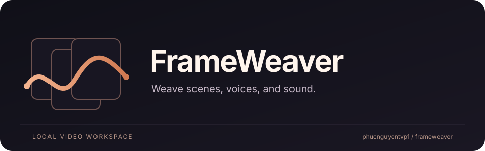
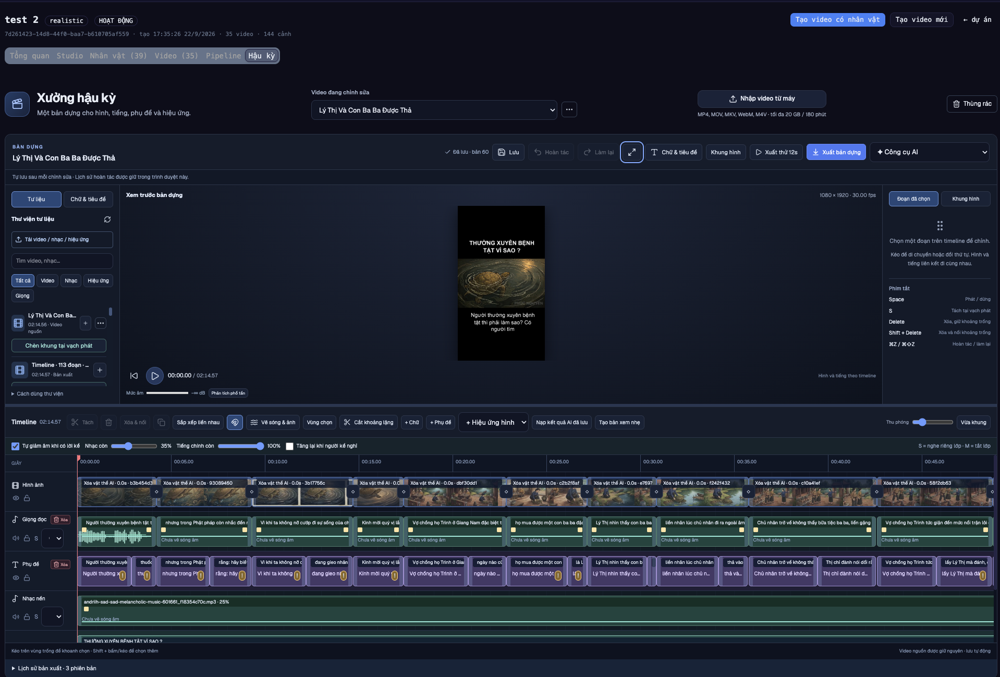
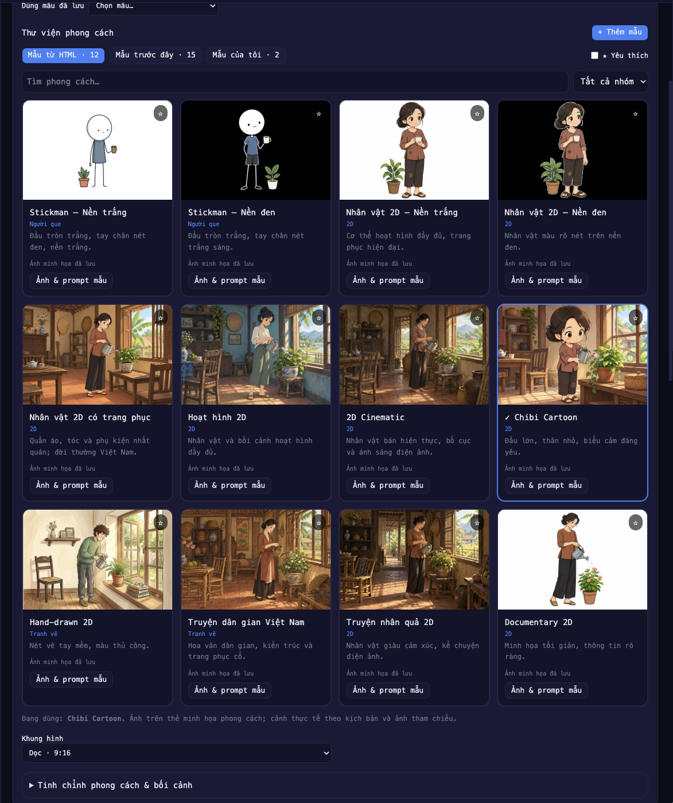
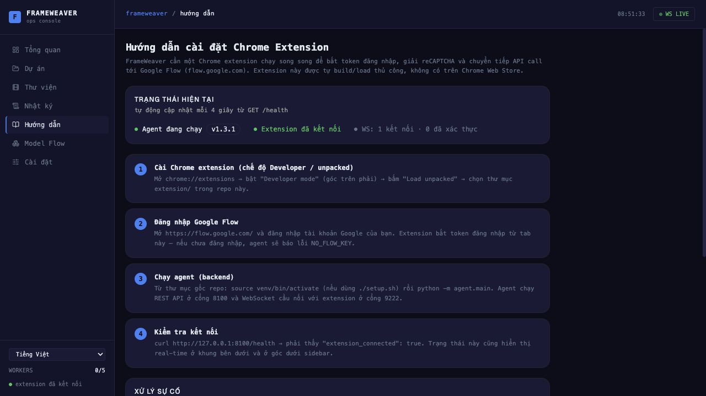

<p align="center">
  
</p>

<p align="center">
  <a href="LICENSE"></a>
  
  
  
  
</p>

<p align="center">
  <a href="README.vi.md">Tiếng Việt</a> ·
  <a href="#quick-start">Quick start</a> ·
  <a href="#documentation">Documentation</a> ·
  <a href="https://github.com/phucnguyentvp1/frameweaver/releases">Downloads</a> ·
  <a href="https://github.com/phucnguyentvp1/frameweaver/issues">Report an issue</a>
</p>

# FrameWeaver

**A local video workspace for scenes, narration, audio, and timeline editing.**

FrameWeaver brings a React dashboard, Python backend, and Chrome extension into
one workflow. Plan scenes, reuse character references, generate through your own
Google Flow session, prepare narration, and assemble clips with FFmpeg.

Developed and maintained by [phucnguyentvp1](https://github.com/phucnguyentvp1),
FrameWeaver combines scene production with a broader editing workspace: layered
timelines, media libraries, speech analysis, narration, subtitles, and saved exports.
The project is currently available as a preview release.

## macOS desktop beta

**[Download FrameWeaver 1.3.1 beta 1 for Mac](https://github.com/phucnguyentvp1/frameweaver/releases/tag/v1.3.1-beta.1)**
— Apple Silicon (M1 or later), macOS 13+, approximately 241 MB.

The DMG is Developer ID signed, Apple notarized, and stapled. Open it and drag
FrameWeaver into Applications; Python and FFmpeg are included. Optional AI models
and provider accounts are configured separately.

This desktop installer keeps the application snapshot packaged on **17 October
2026**. Source documentation continues independently; use the
[desktop release notes](docs/releases/v1.3.1-beta.1-macos.md) for its exact scope,
installation steps, and limitations. The source setup instructions below are for
running from the repository.

## Creator showcase

**YouTube Shorts. Reels. Illustrated stories. Stickman explainers. 2D characters — and more.**

Turn a story into scenes, add narration and subtitles, then shape the result in
the timeline. These demo previews were shared by the FrameWeaver maintainer.

<table>
  <tr>
    <th width="33%">Illustrated moral stories</th>
    <th width="33%">Stickman storytelling</th>
    <th width="33%">2D family stories</th>
  </tr>
  <tr>
    <td align="center" valign="top"><a href="docs/images/showcase/karma-story-short.png"></a></td>
    <td align="center" valign="top"><a href="docs/images/showcase/stickman-family-short.png"></a></td>
    <td align="center" valign="top"><a href="docs/images/showcase/illustrated-family-short.png"></a></td>
  </tr>
  <tr>
    <td>Atmospheric illustrations, a story title, and timed narration.</td>
    <td>Simple characters for everyday stories and explainers.</td>
    <td>Character-led stories with coordinated captions and audio.</td>
  </tr>
</table>

Explore the [demo and workspace gallery](docs/SHOWCASE.md) for full-size previews.

## What you can do

| Workspace | Capabilities |
| --- | --- |
| Scene production | Projects, characters, reference images, scene prompts, image/video generation queues, and stage monitoring |
| Browser bridge | Chrome Manifest V3 extension for requests made inside your signed-in Google Flow tab |
| Story styles | Illustrated style library, stickman and 2D characters, favorites, custom image references, and reusable production templates |
| Narration and subtitles | Narration scripts, SRT editing, voice selection, and optional local TTS integrations |
| Speech analysis | Optional transcription and timing tools for preparing and refining spoken content |
| Audio and editing | Music and effects libraries, audio mixing, captions, frame/layout controls, and FFmpeg export |
| Timeline | Drag media onto tracks, reorder and trim clips, split at the playhead, add transitions, preview, and save exports |
| Media management | Local media libraries, imported videos, reusable audio, and export history |
| Agent workflows | Markdown `/fk-*` recipes for compatible coding agents and configurable CLI providers |
| Interface languages | English, Vietnamese, Hindi, Indonesian, Chinese, Korean, and Japanese |

Optional engines need their own dependencies and model downloads. AI generation
uses your service account and applicable credits; this repository does not include
Google Flow access, a paid AI subscription, or provider credentials.

## Inside the workspace

### Drag-and-drop timeline

<a href="docs/images/showcase/timeline-editor.png"></a>

Bring video, narration, subtitles, music, and overlays together in one edit.
Drag assets from the library onto tracks, move clips into place, split at the
playhead, adjust the frame, and preview before exporting. The workspace includes
audio ducking, undo/redo, autosave, and saved export history.

### A visual library for your next story

Choose a look before building the scenes: light or dark stickman styles, 2D
characters, cinematic illustration, chibi, hand-drawn art, Vietnamese folk stories,
and illustrated moral stories. Save favorites or add your own reference-based style.

<details>
  <summary><strong>Open the style library preview</strong></summary>
  <p><a href="docs/images/showcase/style-library.png"></a></p>
</details>

<details>
  <summary><strong>Open the dashboard and connection guide</strong></summary>
  <p></p>
  <p>The Chrome extension popup and panel use <strong>FrameWeaver 0.3.5</strong>. See the <a href="docs/images/frameweaver_extension.jpg">extension UI preview</a>.</p>
</details>

## Quick start

### 1. Install the prerequisites

The packaging checks used **Python 3.12** and **Node.js 24**. You also need Chrome,
FFmpeg, and ffprobe. Install those tools before proceeding.

The commands below assume macOS or a Linux shell. Windows users can adapt them
with WSL; a full Windows setup has not been verified for this preview.

### 2. Clone and install the backend

```sh
git clone https://github.com/phucnguyentvp1/frameweaver.git
cd frameweaver
python3.12 -m venv .venv
source .venv/bin/activate
python -m pip install -r requirements.txt
cp .env.example .env
```

Create a project in the Google Flow interface. Copy its UUID from the project URL
and set `FLOW_PROJECT_ID` in `.env`. Use your own credentials for any optional
providers you enable.

```sh
set -a
source .env
set +a
python -m agent.main
```

The backend reads shell environment variables; it does **not** load `.env`
automatically. Leave this terminal running.

### 3. Load the extension

Open Chrome's extension manager, enable Developer mode, choose **Load unpacked**,
and select this repository's `extension/` directory. Open
[Google Flow](https://flow.google.com/), sign in, and leave the tab open.

For a standalone extension download, extract the ZIP first and select the folder
containing `manifest.json`. Keep one bridge enabled for the same backend. An
extension loaded from another copy of the project will keep using that copy's
files. See the [extension installation guide](extension/README.md).

### 4. Start the dashboard

In a second terminal:

```sh
cd frameweaver/dashboard
npm ci
npm run dev
```

Open **http://127.0.0.1:5173**. The backend uses port **8100** and the extension
WebSocket bridge uses **9222**. Keep these services bound to localhost for a
normal desktop installation.

### 5. Check the connection

```sh
curl -s http://127.0.0.1:8100/health
curl -s http://127.0.0.1:8100/api/flow/status
```

Before generation, the health response must show `extension_connected: true`.
The Flow status should identify the `batch` transport and your project UUID.
`flow_key_present: false` is expected for the current browser transport.

## A typical workflow

1. Create a local project and link your Google Flow project.
2. Define recurring characters, locations, and props; generate all references first.
3. Add scenes using action prompts and the relevant reference entities.
4. Generate scene images, then video clips, through the request queue.
5. Review the clips before any supported upscale operation.
6. Prepare narration, subtitles, music, and timeline edits.
7. Export a preview or final MP4 and download it.

Use `POST /api/requests/batch` for bulk generation. The server handles concurrency
and cooldowns. `/fk-*` recipes in [skills/](skills/README.md) describe the API
workflow and its checks.

## Architecture

```text
React dashboard (:5173) ── HTTP / WebSocket ── Python agent (:8100)
                                                   │
                                             SQLite + FFmpeg
                                                   │
                                          Extension bridge (:9222)
                                                   │
                                        Signed-in Google Flow tab
```

The application stores project data, generated media, and local settings on the
machine running the backend. A source download contains code and bundled preview
assets; each user configures their own browser session and optional providers.

## Configuration

| Variable | Purpose |
| --- | --- |
| `FLOW_PROJECT_ID` | UUID of the Google Flow project used by browser generation |
| `API_HOST`, `API_PORT` | Backend bind address and port; defaults to `127.0.0.1:8100` |
| `WS_HOST`, `WS_PORT` | Extension bridge bind address and port; defaults to `127.0.0.1:9222` |
| `FLOW_ALLOW_DEGRADED` | Optional fallback for unsupported Veo reference/chaining modes; default `0` |
| `ANTHROPIC_API_KEY`, `SUNO_API_KEY` | Optional provider credentials; leave unset unless needed |
| `VITE_MODEL_CATALOG_URL` | Optional dashboard override for the public model-catalog JSON URL |

Existing `.flowkit/` paths, `FLOWKIT_*` settings, and `/fk-*` commands are retained
for compatibility with the base implementation. See [BRANDING.md](BRANDING.md).

## Preview status and known limitations

- **Veo video upscale, Veo reference-to-video, and Veo start/end-frame chaining**
  are marked unported on the migrated transport. Supported Omni modes and
  explicitly enabled fallbacks have different behavior; consult
  [the transport notes](docs/CAPTURE.md).
- Generation depends on Google Flow's current browser behavior and your account.
  Live generation has not been re-verified for this preview release.
- External macOS volumes exposed AppleDouble (`._*`) discovery and modification-time
  cache failures during packaging checks. For a macOS trial, use native APFS
  working data and temporary directories. Packaging excludes metadata files but
  does not repair all runtime filesystem assumptions.
- TTS, speech analysis, and restoration engines are optional integrations with
  separate installation, model, and licensing requirements.
- Saved project titles and original uploaded filenames keep their user-provided
  names. App-generated image/video export names use the `frameweaver-` prefix.

Focused publication checks passed for backend download/editing/auth/package
paths, the MV3 bootstrap test, and the dashboard production build. A clean full
cross-platform test result is not claimed for this preview.

## Documentation

| Guide | Contents |
| --- | --- |
| [Sharing and installation](docs/SHARING.md) | Environment setup, source archives, and distribution notes |
| [Demo and workspace gallery](docs/SHOWCASE.md) | Creator examples, the timeline editor, style library, and dashboard |
| [Technical reference](docs/REFERENCE.md) | Detailed API and workflow reference, including historical examples |
| [Timeline editor](docs/TIMELINE_EDITOR.md) | Editing controls, save behavior, and export |
| [Speech analysis](docs/speech-analysis.md) | Optional speech-analysis workflow |
| [Kokoro](docs/kokoro-english.md) / [Qwen3](docs/qwen3-multilingual.md) | Optional narration engines |
| [Export history](docs/EXPORT_HISTORY.md) | Managing saved exports and their dependencies |
| [Agent workflows](skills/README.md) | `/fk-*` recipes and setup |
| [Contributing](CONTRIBUTING.md) | Development checks and contribution guidance |
| [Security](SECURITY.md) | Private vulnerability reporting |

## Development

```sh
source .venv/bin/activate
python -m pip install -r requirements.txt -r requirements-dev.txt
python -m pytest tests/unit
node --test tests/*.test.cjs tests/*.test.mjs dashboard/tests/speechRepair.test.ts
```

```sh
cd dashboard
npm ci
npm run build
```

The CI workflow runs backend unit checks and a frontend build. Optional model
inference and live Google Flow generation are not part of those checks.

## Roadmap

The next priorities are a reproducible first-run experience, external-volume
compatibility, broader platform validation, and video walkthroughs showing
the FrameWeaver workflow. Proposed changes are welcome through
[issues](https://github.com/phucnguyentvp1/frameweaver/issues).

## License and acknowledgements

FrameWeaver is distributed under the **MIT** license. It includes code adapted
from [Flow Kit](https://github.com/crisng95/flowkit); the original copyright and
permission notice are preserved in [LICENSE](LICENSE) for that reused code.
FrameWeaver's additional features and changes are maintained in this repository.
Bundled voice previews and other third-party resources have their own terms;
read [THIRD_PARTY_NOTICES.md](THIRD_PARTY_NOTICES.md) before redistribution or
commercial use of those assets.

Thanks to the [Flow Kit authors and contributors](https://github.com/crisng95/flowkit)
and the projects powering the optional integrations. FrameWeaver is a community
project and is not affiliated with Google, Anthropic, or OpenAI.
